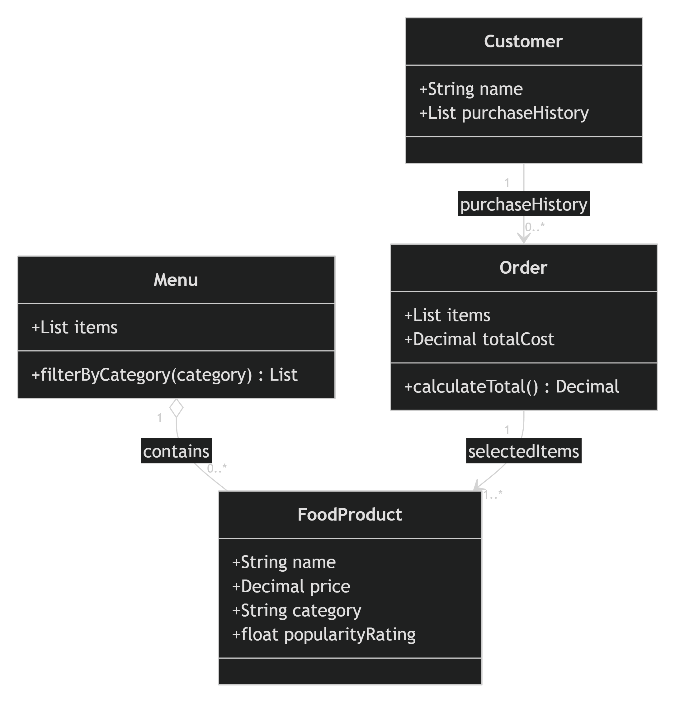

 
Customer

Represents a registered ByteBites customer and stores their purchase history.

Attributes

name : String – Customer's name
purchaseHistory : List<Order> – Collection of the customer's past orders
FoodProduct

Represents a food or drink item available for purchase.

Attributes

name : String – Product name (e.g., Spicy Burger)
price : Decimal – Product price
category : String – Product category (e.g., Drinks, Desserts)
popularityRating : float – Popularity score or rating
Menu

Represents the collection of all food products available in the application.

Attributes

items : List<FoodProduct> – List of all available food products

Function

filterByCategory(category) : List<FoodProduct>
Returns all food products that belong to the specified category.
Order

Represents a customer's transaction containing selected food products.

Attributes

items : List<FoodProduct> – Products selected in the order
totalCost : Decimal – Total cost of all products in the order

Function

calculateTotal() : Decimal
Calculates and returns the total cost of all items in the order.